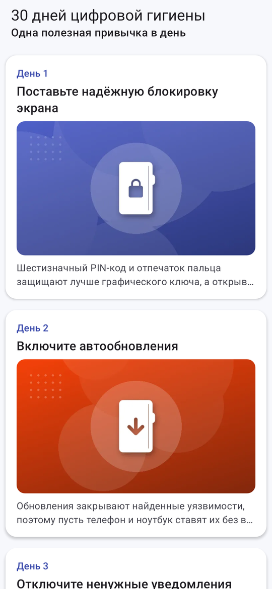
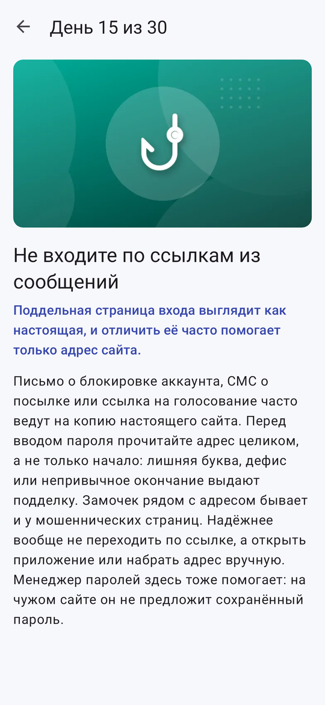
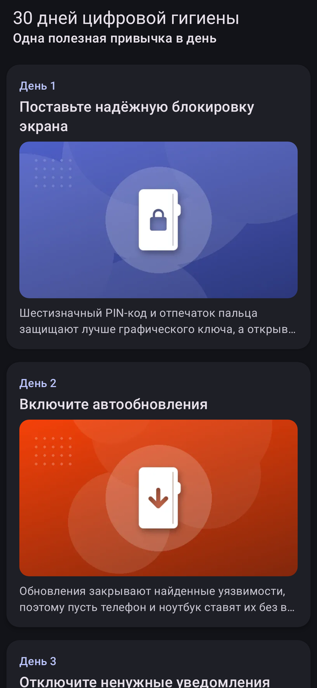
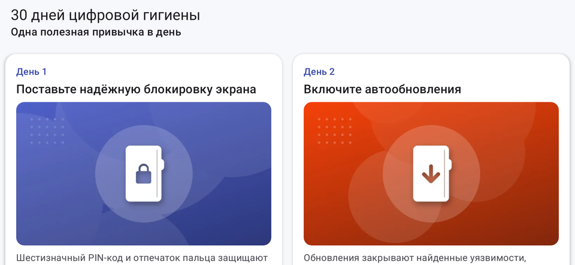

# 30 дней цифровой гигиены

Лабораторная работа № 3 «Советы на каждый день». Тема — цифровая гигиена: по одному небольшому делу на каждый день месяца, от блокировки экрана до шифрования диска. Вёрстка только на XML, список — RecyclerView.

## Что сделано

- Ровно 30 советов. У каждого номер дня, заголовок, иллюстрация, краткое описание в две строки и полный текст.
- Модель `data class Tip`, источник данных `TipsDataSource.loadTips()`, доступ через `TipsRepository`. Тексты всех советов — в `strings.xml`, в коде только идентификаторы ресурсов.
- Свой адаптер `TipsAdapter : RecyclerView.Adapter<TipViewHolder>`. `TipViewHolder` один раз находит элементы через `findViewById` в конструкторе, а `onBindViewHolder` только раскладывает данные по ним.
- Карточка — отдельная разметка `item_tip.xml` на `MaterialCardView`: скруглённые углы, тень, отступы.
- По нажатию на карточку открывается `TipDetailActivity`, номер дня передаётся через `Intent`. На экране совета большая иллюстрация и полный текст.
- Данные экранам отдают `TipsViewModel` и `TipDetailViewModel` (создаются через свои фабрики), списки — через `LiveData`.
- На телефоне в портрете список в одну колонку. В альбомной ориентации и на планшете — сетка `GridLayoutManager` на 2–3 колонки, число берётся из ресурсов `integers.xml`.
- Интерфейс и сами советы на русском и английском (`values`, `values-en`, `values-ru`), есть тёмная тема.

## Иллюстрации

Картинки нарисованы для этого приложения: градиент цвета дня и значок из набора Material Symbols (лицензия Apache 2.0). Формат WebP 720 × 405, лежат в `res/drawable-xhdpi`, все вместе около 160 КБ.

Тесты репозитория — `gradlew testDebugUnitTest`.

## Экраны

| Список | Совет дня | Тёмная тема |
|---|---|---|
|  |  |  |

Альбомная ориентация — сетка в две колонки:

